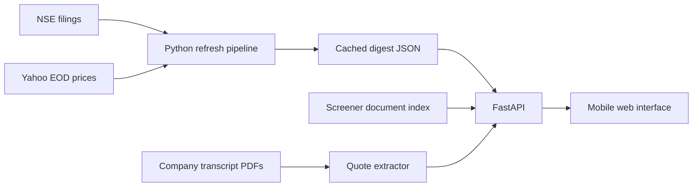

# FINN — a source-first portfolio brief

FINN is a mobile-first prototype for an investor following 18 Indian listed companies. The **Brief** defaults to the 24 hours before the cached snapshot, grouping related earnings documents into company events. A seven-day view is one tap away. **Filings** keeps every original announcement searchable, with routine paperwork available on request. **Research** accepts any NSE ticker and renders a filing-verified result grid, management appointments, and a **Promise Tracker** that reconciles prior-call guidance with later disclosure. **Signals** lets investors tune price, volume, and filing-category matches.

Five tickers ship with filing-verified evidence extracted from NSE Outcome PDFs: **DIXON** (hand-curated), **RELIANCE**, **INFY**, **HDFCBANK**, and **LT**. The Promise Tracker covers Dixon, Reliance, and Infosys. Every number, bio, and verdict links back to a specific page of the source PDF.

## Run locally

Requires Python 3.12 or newer.

```powershell
python -m pip install -r requirements.txt
python -m uvicorn app:app --reload
```

Open `http://127.0.0.1:8000`. The committed snapshots work without any API key — the five verified tickers plus the research page for all 20 cached companies are precomputed JSON. For a 60-second tour, open **Research → RELIANCE** or **INFY**: the results grid, the Promise Tracker's "earlier statement vs later disclosure" pair, and every page-linked source are the heart of the prototype.

To refresh public data (requires `GEMINI_API_KEY` in `.env` for the LLM extractors):

```powershell
python pipeline/build_digest.py --days 30
python pipeline/cache_research.py
python pipeline/build_evidence.py RELIANCE INFY HDFCBANK LT   # LLM: results grid + appointment bios
python pipeline/build_promises.py DIXON INFY RELIANCE          # LLM: promise reconciliation
python pipeline/cache_claims.py                                # transcript candidates for ad-hoc tickers
```

The first command fetches NSE filings for the 18-stock portfolio and recent Yahoo Finance end-of-day prices. To try a smaller set, run `python pipeline/build_digest.py --symbols RELIANCE DIXON`. Tickers outside the cache are loaded from Screener live when requested — the engine works on any NSE symbol.

## Architecture



The push pipeline uses explicit category keywords and a small explainable priority score — no LLM, so filing triage is zero-cost and the judgment is inspectable. The evidence pipeline sends each Outcome PDF to Gemini 3.5 Flash (model-chain fallback: 3.5-flash → flash-latest → flash-lite → 3.8-flash → pro-latest) with a strict JSON schema and deterministic sanity checks: wrong unit, PBT < PAT, or a >10× magnitude swing on a cell cause the whole grid to be dropped rather than published. The Promise Tracker calls Gemini once per ticker with both the prior transcript and the later filing, under instructions that force `pending` whenever the metric, period, or basis is not an exact match. The pipeline self-test (`scratchpad/test_dixon_extract.py`) reproduces the hand-verified Dixon grid to 0.1% across all 12 cells.

Every LLM call is cached under `.cache/llm/` by `(model, prompt, pdf-hash, schema)`. Mirrored PDFs sit under `data/pdf-cache/` and are served at `/pdf-cache/<file>` so the UI survives NSE URL expiry or IP blocks. The deployed app reads cached JSON only — no Gemini call runs at demo time.

## Product choices and limits

- **Events before documents.** The Brief joins quarterly results, presentations, call recordings, transcripts, and closely related exchange announcements when they belong to one company event. One lead development and up to four follow-ups appear first; each expands to its complete source trail. The seven-day snapshot powers a 24-hour default view and a seven-day alternative. The full archive retains all 88 source filings, with search, company and time filters, pagination, and an option to include routine items. The reviewed state is local to this browser.
- **User-defined signals.** Price move, volume multiple, and filing categories are saved locally in the browser. The Signals screen initially previews five matches and offers the complete list on request. This prototype does not send push notifications.
- **Primary sources are close.** Dixon's result figures, appointment bio, and transcript statement link to specific filing pages. Its reported EBITDA comparison uses the company's half-year total to derive the prior quarter and says so in the interface. The management comparison also links the later result filing that was checked. Other tickers show their exchange filings, annual reports, and call transcripts; the interface withholds a results comparison until it has filing-verified figures.
- **No fabricated verdicts.** The guidance ledger offers source-linked candidate sentences. It does not mark a statement delivered or missed until its metric, period, segment, and speaker are matched to a later primary filing. PDF text extraction can have spacing errors.
- **No model cost or key required.** Classification and extraction are deterministic. A later version could route only ambiguous filings and claim matching to a model, cache by document hash, and require a source quote for every generated conclusion.

The filing-verified result and bio extraction now ships for five tickers (Dixon curated, Reliance, Infy, HDFC Bank, L&T via the LLM extractor). The Promise Tracker ships for Dixon, Reliance and Infy. L&T's promise call hit a Gemini quota during build and HDFCBANK's prior transcript PDF was unparseable — both tickers fall through to their verified results grid plus the document trail; a repeat build will fill them in. The refresh depends on unofficial NSE and Yahoo clients, and the live research document index depends on Screener's current HTML. Committed snapshots keep the main demo available during source outages.

## Submission status

Ready to deploy from the included Dockerfile to any Python-capable host. The assignment PDF states a deadline of **1 November 2026**; this submission is 2 days late and the covering email acknowledges it up front.
