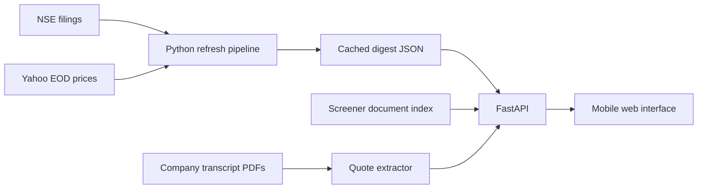

# FINN — a source-first portfolio brief

FINN is a mobile-first prototype for an investor following 18 Indian listed companies. The **Today** inbox ranks recent NSE filings, folds away routine paperwork, and flags configurable filing and end-of-day price signals. The **Research** desk accepts any NSE ticker that has a public Screener page and points to the company's reports and call transcripts. A small guidance ledger extracts page-linked quantitative statements from transcript PDFs.

## Run locally

Requires Python 3.12 or newer.

```powershell
python -m pip install -r requirements.txt
python -m uvicorn app:app --reload
```

Open `http://127.0.0.1:8000`. The committed snapshots work without API keys. To refresh public data:

```powershell
python pipeline/build_digest.py --days 7
python pipeline/cache_research.py
python pipeline/cache_claims.py
```

The first command fetches NSE filings for the 18-stock portfolio and recent Yahoo Finance end-of-day prices. It can take a few minutes. To try a smaller set, run `python pipeline/build_digest.py --symbols RELIANCE DIXON`. The research cache covers the portfolio plus ASTRAL and PIDILITIND for a responsive demo; other tickers are loaded from Screener when requested. The transcript evidence cache contains RELIANCE and DIXON; other tickers are extracted on demand.

## Architecture



The refresh pipeline uses explicit category keywords and a small explainable priority score. It does not call an LLM. The transcript extractor selects quantitative forward-looking sentences, then retains the PDF URL and page number. Cached public snapshots make the demo resilient to temporary source outages. A GitHub Actions workflow can refresh and commit them at 18:45 IST on weekdays once the repository is published with write permission.

## Product choices and limits

- **Triage over a raw feed.** Material filings stay visible; routine filings are available in a collapsed group. Every card links to the exchange PDF and the company research view.
- **User-defined signals.** Price move, volume multiple, and filing categories are saved locally in the browser. Signals are evaluated against the latest cached data. This prototype does not send push notifications.
- **Primary sources are close.** Research links to company annual reports and earnings-call transcripts. The quarterly comparison uses Screener's standardized table as a quick orientation and labels operating profit as an EBITDA proxy; confirm each figure against the company filing before using it in a decision.
- **No fabricated verdicts.** The guidance ledger offers source-linked candidate sentences. It does not mark a statement delivered or missed until its metric, period, segment, and speaker are matched to a later primary filing. PDF text extraction can have spacing errors.
- **No model cost or key required.** Classification and extraction are deterministic. A later version could route only ambiguous filings and claim matching to a model, cache by document hash, and require a source quote for every generated conclusion.

The current prototype does not yet extract the incoming person's bio from management filings, generate a complete four-metric results card directly from the exchange PDF, or send instant alerts. Those are the next high-value extensions. The refresh depends on unofficial NSE and Yahoo clients, and the live research page depends on Screener's current HTML; failures should be surfaced and the last cached snapshot retained.

## Submission status

This repository is ready for review locally or in a Python-capable container host using the included Dockerfile. A public URL, GitHub remote, and covering email still need to be added before submission. The assignment PDF states a deadline of **November 1, 2026**; check with ENAM whether a late submission will be accepted.
