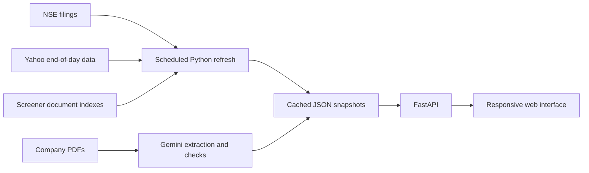

# FINN — a source-first portfolio filing desk

[Open the live prototype](https://finn-enam-2343.onrender.com/) · [View the source code](https://github.com/Kshitiztyagi23/finn-enam)

FINN helps an investor follow 18 NSE-listed companies. It groups related exchange announcements into readable developments, keeps the original filings close, and compares selected company results with earlier management statements. It is a responsive web app built with FastAPI, plain JavaScript, and cached public data.

The Render service may take about 30 seconds to wake after being idle. The app shows the timestamp of the filing snapshot it is displaying.

## Take a one-minute tour

1. **Brief:** Read the lead development, switch between the 24-hour and seven-day views, and expand an event to see its source filings. These windows end at the cached snapshot time.
2. **Research:** Open **DIXON** for the hand-curated results comparison and a management statement with its later disclosure check. Open **RELIANCE** or **INFY** to see the automated results and Promise Tracker examples. Follow the PDF page links to inspect the evidence.
3. **Filings:** Search by company or subject, change the time filter, and include routine announcements to see the full cached filing trail.
4. **Signals:** Adjust filing categories, daily price moves, and volume thresholds to preview matches. The settings are saved in this browser. The header also has a light/dark theme toggle.

## What is implemented

| View | Current behavior |
| --- | --- |
| Brief | Ranks portfolio developments using filing type and end-of-day market context. Related results, presentations, and transcripts are grouped into one expandable event. |
| Filings | Searchable, paginated archive of every announcement in the current cached snapshot, including routine filings on request. |
| Research | Accepts an NSE ticker. Five companies have source-linked result grids: **DIXON**, **RELIANCE**, **INFY**, **HDFCBANK**, and **LT**. Other tickers show available exchange filings, annual reports, and transcripts without presenting an unverified results grid. |
| Promise Tracker | Compares earlier call statements with later disclosures for **DIXON**, **RELIANCE**, and **INFY**. A statement stays `pending` when the later document does not report a directly comparable metric. |
| Signals | Browser-local filing, price-move, and volume settings with a preview of matches from the cached snapshot. |

Dixon's result grid was curated by hand. The other four result grids were extracted from company PDFs with Gemini and passed programmed checks for units, missing metrics, and implausible changes before being saved. The Promise Tracker also uses Gemini to compare a prior transcript with a later filing. Each displayed comparison provides source links so readers can inspect the underlying documents. HDFCBANK and LT have results grids but no completed Promise Tracker examples in the bundled evidence.

## Run locally

Use Python 3.12 or newer:

```powershell
python -m pip install -r requirements.txt
python -m uvicorn app:app --reload
```

Open <http://127.0.0.1:8000>. The committed snapshots and five evidence examples work without an API key. Research pages for 20 companies are cached; a ticker outside that cache makes a live request to Screener for its document index and may fail if that site is unavailable.

## Data and refresh

The weekday [GitHub Actions workflow](.github/workflows/refresh.yml) refreshes the NSE filing digest, Yahoo Finance end-of-day market context, cached company document indexes, and transcript candidates at **18:45 IST**. It commits the new public snapshots under `data/`. The five results grids and three Promise Tracker examples are separate evidence snapshots; that scheduled workflow does **not** rebuild them.

To refresh public snapshots yourself:

```powershell
python pipeline/build_digest.py --days 7
python pipeline/cache_research.py
python pipeline/cache_claims.py
```

To rebuild model-extracted evidence, put `GEMINI_API_KEY` in a local `.env` file, then run:

```powershell
python pipeline/build_evidence.py RELIANCE INFY HDFCBANK LT
python pipeline/build_promises.py DIXON INFY RELIANCE
```

The evidence stage uses structured JSON output and rejects result grids that fail its sanity checks. Its model calls are cached under `.cache/llm/` by the input and model configuration. Some source PDFs are stored under `data/pdf-cache/` for inspection; the interface currently links to the original source URLs. The deployed app serves saved JSON and makes no Gemini call when a visitor opens a page.



## Current limits

- The filing snapshot refreshes on a schedule; the result grids and Promise Tracker examples remain fixed until their evidence builders are run again. Always check the date of a comparison before using it.
- Signals preview matches in the app. There are no phone, email, or browser push notifications.
- The Promise Tracker covers three companies and selected statements, not four quarters of every portfolio company's guidance. The extracted comparisons have page links and still warrant human review.
- Live research for uncached tickers depends on Screener. The refresh pipeline depends on external NSE and Yahoo clients, which can temporarily fail.

The app is deployed on Render using the included [Dockerfile](Dockerfile).
